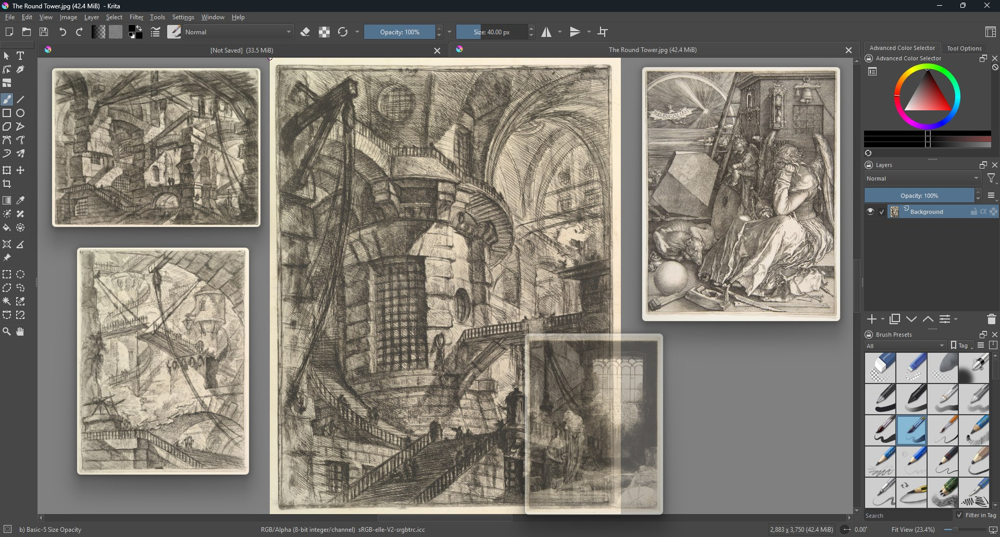
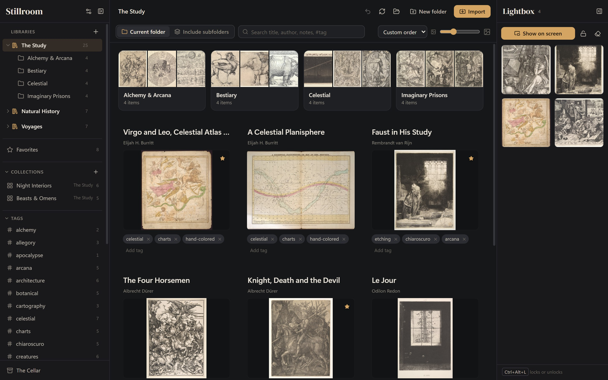
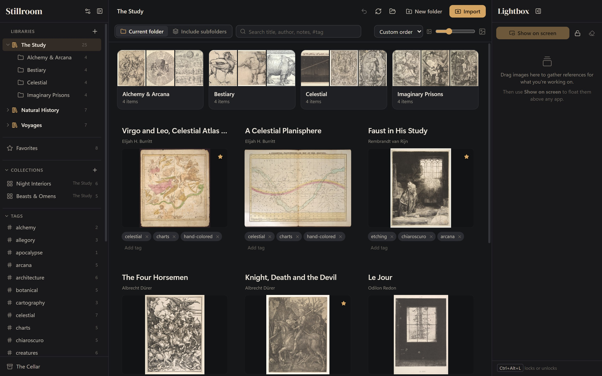
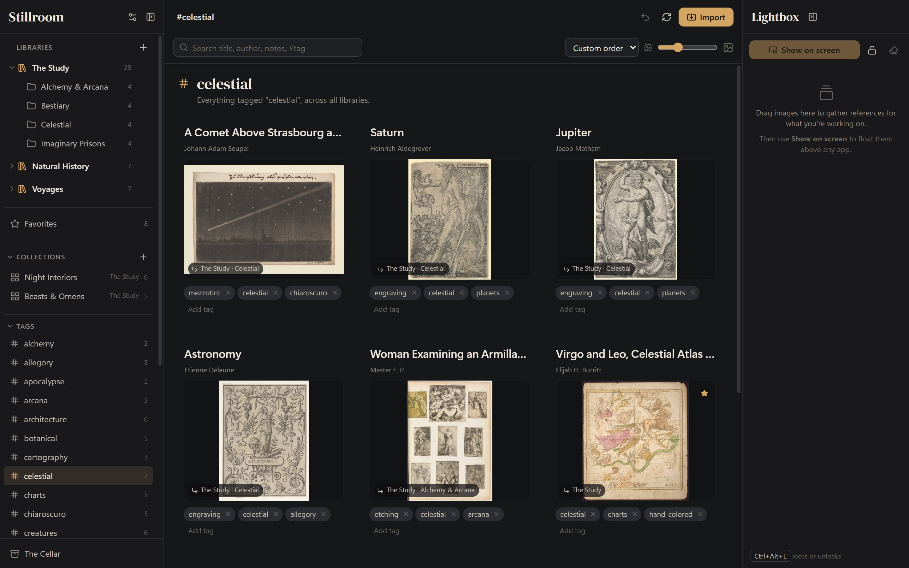
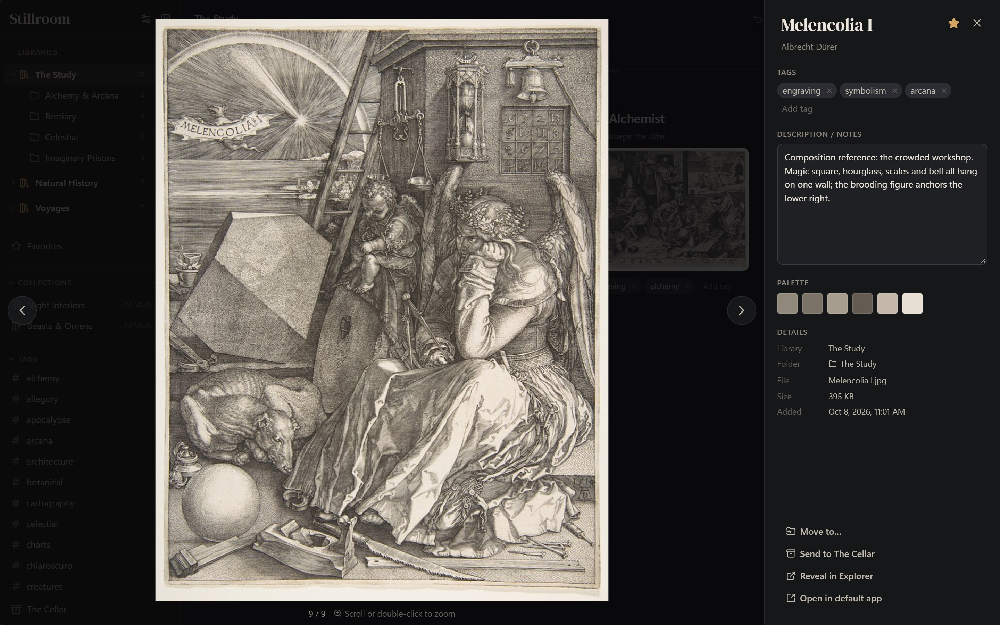
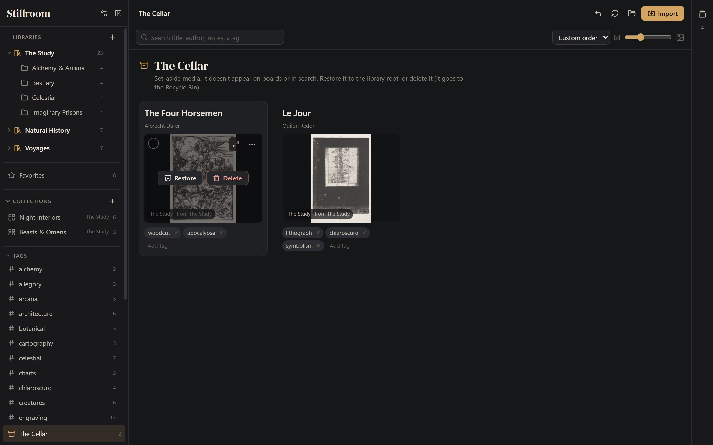
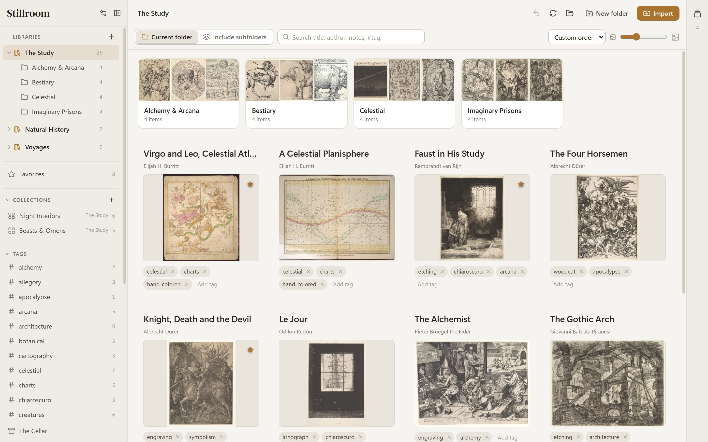
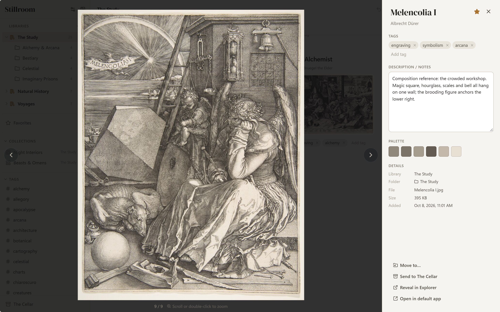

<h1 align="center">Stillroom</h1>

  <strong>A quiet, local library for your visual references.</strong> 
  Your folders are the boards. Tags, notes and collections on top. Nothing uploaded, no account.

  <a href="https://github.com/remiionline/stillroom-release/releases/latest"><strong>⬇ Download the latest beta for Windows</strong></a>
  &nbsp;·&nbsp; Windows 10 / 11 (64-bit) &nbsp;·&nbsp; Free 
  <a href="https://stillroom.cc">stillroom.cc</a>

> **New in 0.4.0: the Lightbox.** Gather references in a tray, then float them above
> any app while you work. See the [changelog](CHANGELOG.md) for everything new.

---

## What it is

Stillroom is a reference manager for artists, designers and anyone who collects
images. It works with the folders already on your disk: point it at a folder and
every subfolder becomes a board. Stillroom adds tags, notes, favorites and
collections on top, without moving your files into a hidden database. Your
images stay ordinary files, and you can still open them in Explorer.

Everything stays on your computer. Stillroom doesn't need an account, doesn't
upload anything, and works offline.

> **Beta:** Stillroom is in public beta. Please read [Before you start](#before-you-start)
> before adding a collection you care about.

## Features

**The Lightbox** (new in 0.4.0)
- A tray on the right edge of the window. Drag images in from any board, or right-click → **Add to Lightbox**.
- **Show on screen** floats each image in its own small window above every other app, so it stays in view while you paint, model or design.
- Drag to move. Drag the corner or scroll to resize, keeping the proportions. Hover for an opacity slider so the work underneath shows through.
- **Lock** with the button or **Ctrl+Alt+L** from any app: images stay put and clicks pass straight through to the app underneath.

**Your folders are the library**
- Any folder becomes a library; its subfolders are boards. Keep several libraries open at once.
- Create, rename, move and delete folders from inside Stillroom; the changes happen on disk.
- Live updates: change files in Explorer and Stillroom catches up. Tags and notes follow files that move inside the library.

**Organize**
- Tags with suggestions, notes that save as you type, author credits, and favorites.
- Collections group references from different folders without moving or copying files.
- Drag items into folders and collections, or drag to arrange them in your own order.
- Multi-select for bulk tagging and moving, right-click menus, and **Ctrl+Z** to undo.

**Find**
- Search titles, authors, notes and tags. Type `#tag` to match tags only.
- Include subfolders, sort several ways, resize thumbnails.

**View**
- A full viewer with zoom, pan, arrow-key browsing and each image's colour palette.
- Video playback, with first-frame thumbnails.

**The Cellar**
- Set media aside instead of deleting it. It leaves boards and search but keeps its tags and notes.
- Restore it later, or delete it to the Recycle Bin.

**Built for big collections**
- Tested with 30,000-item libraries. Thumbnails are made in the background.
- Dark, light, or match-your-system theme.

  
  

## Install

1. Download `Stillroom_X.Y.Z_x64-setup.exe` from the [latest release](https://github.com/remiionline/stillroom-release/releases/latest).
2. Run it. Stillroom isn't code-signed yet, so Windows shows **"Windows protected your PC"**:
   click **More info**, then **Run anyway**.
3. No admin rights are needed. Stillroom installs just for your user account.

If there's no "Run anyway" option, your PC has **Smart App Control** turned on.
It blocks unsigned apps, and Stillroom can't run there until a signed version is
available.

**Requirements:** Windows 10 or 11, 64-bit. Stillroom has so far been tested on Windows 11.

**Uninstall** from *Settings → Apps*. Your folders and images are left untouched.

## Before you start

This is a beta, and it works with real files on your disk.

- **Back up first.** Renaming, moving and deleting in Stillroom changes the real files.
  Keep a copy of any collection you can't replace.
- **Avoid cloud-synced folders for now.** OneDrive, Dropbox, Google Drive and
  iCloud can conflict with Stillroom's index while syncing, which can lose tags
  and notes. Your images stay safe. Network drives carry the same risk.
- **Deleting** from The Cellar moves the file to the Recycle Bin and removes its
  tags and notes. On network drives and some external drives, Windows skips the
  Recycle Bin, so those deletes are permanent.
- **Updates.** From 0.4.0, Stillroom checks for new versions and installs them when you
  agree (or use **Settings → Check for updates…**). If you're on 0.3.0, install 0.4.0 once
  by hand. Updating always keeps your libraries, tags and notes.

## FAQ

**Does Stillroom change or move my files?**
Only when you ask it to: renaming, moving, importing or deleting. Browsing,
tagging and writing notes never touch your images.

**Where are my tags and notes stored?**
In a hidden `.stillroom` folder inside each library, next to your images, so they
travel with the folder. Deleting that folder removes the tags and notes, never the images.

**Does it upload anything or need the internet?**
No. Stillroom works fully offline and has no account, no analytics and no crash
reporting. Nothing about your images, tags or notes leaves your computer. The only
connection it makes (from 0.4.0) is a check here on GitHub for a newer version.

**Which file types are supported?**
PNG, JPEG, WebP, GIF, BMP, AVIF, SVG and ICO images, plus MP4, WebM, M4V, OGV,
MOV and MKV video. Which video codecs play depends on Windows.

**Can I use it on Mac, Linux or iPad?**
Not yet. Windows comes first, and other platforms may follow.

**Can I use my library on two computers?**
Not safely yet: see the cloud-sync note above. Proper multi-device support is on the roadmap.

## Report a bug or suggest a feature

Open an [issue](https://github.com/remiionline/stillroom-release/issues/new/choose).
The bug form asks for what we need to fix it.

For bugs, please attach your **log file**: in Stillroom, open **Settings (sliders icon)
→ Show log file**, and drag `stillroom.log` into the issue. It records errors and
may include file and folder names, but never image contents or notes.

## Credits

Stillroom is built with [Tauri](https://tauri.app), [Svelte](https://svelte.dev) and
[SQLite](https://sqlite.org), with icons from [Lucide](https://lucide.dev) and the
[DM Serif Display](https://fonts.google.com/specimen/DM+Serif+Display) typeface.
The full list of open-source licenses is in the app under **Settings → Third-party licenses**.

The artworks in these screenshots are public-domain works from
[The Metropolitan Museum of Art](https://www.metmuseum.org/about-the-met/policies-and-documents/open-access)
and [Cooper Hewitt](https://www.cooperhewitt.org/open-access-at-cooper-hewitt/) open-access collections.
The Lightbox screenshot shows the free painting app [Krita](https://krita.org).

---

© 2026 remiionline · Free to download and use

